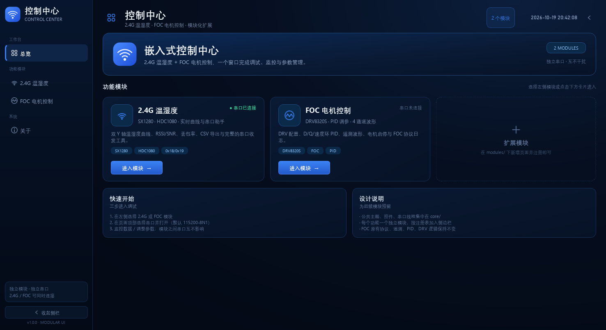
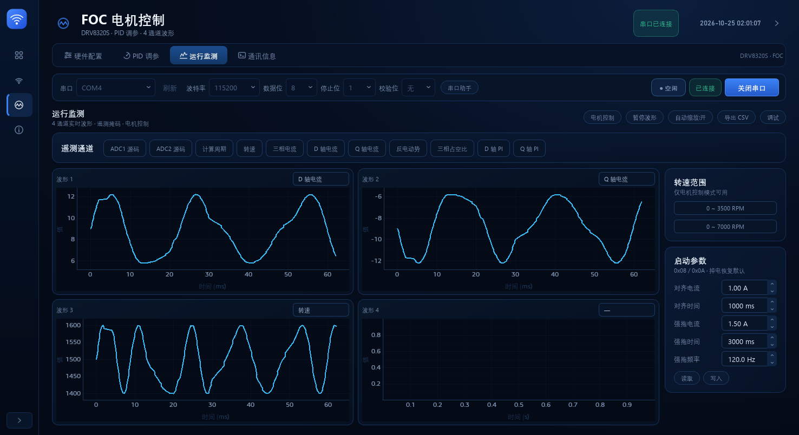
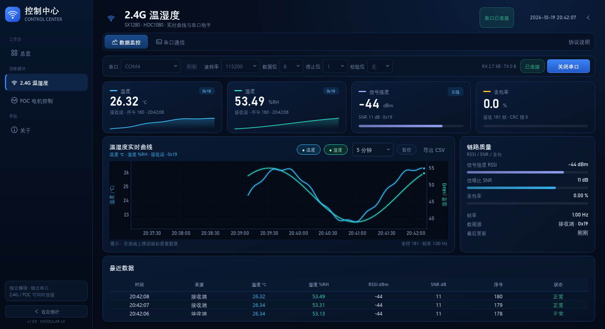
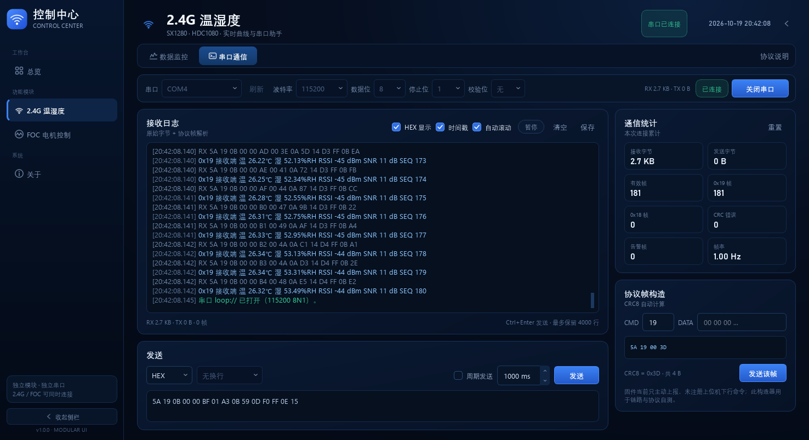
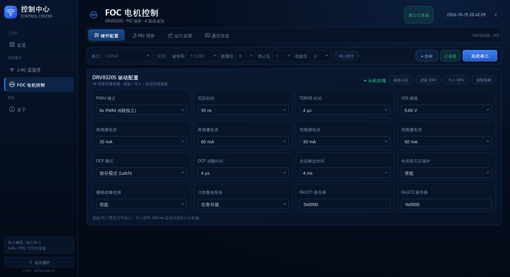
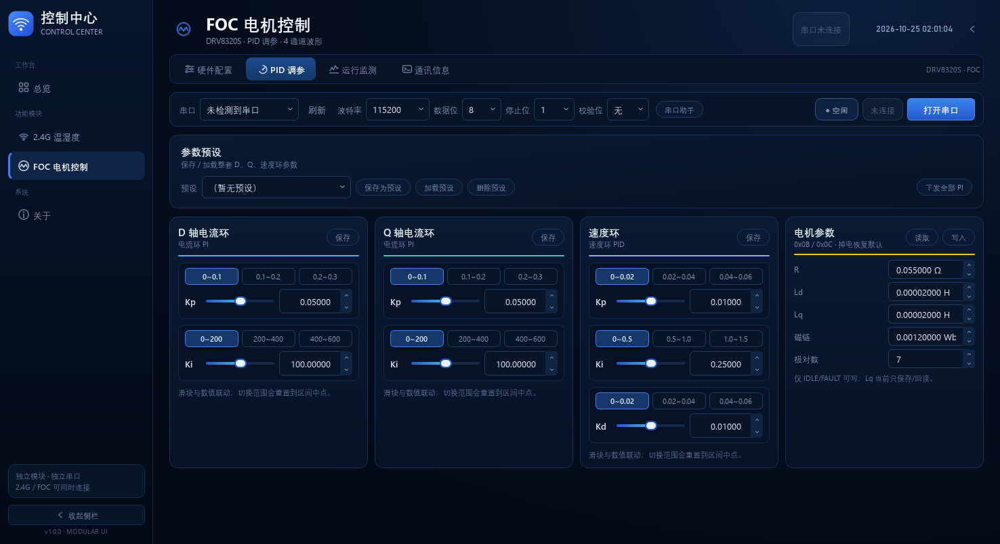
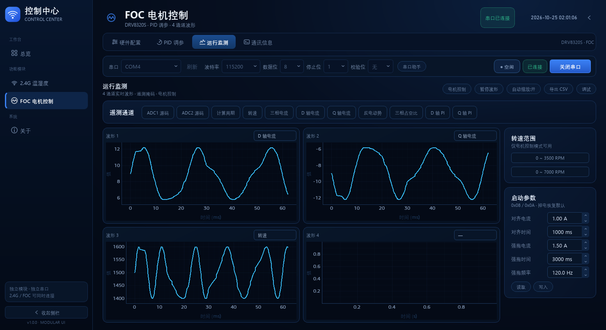
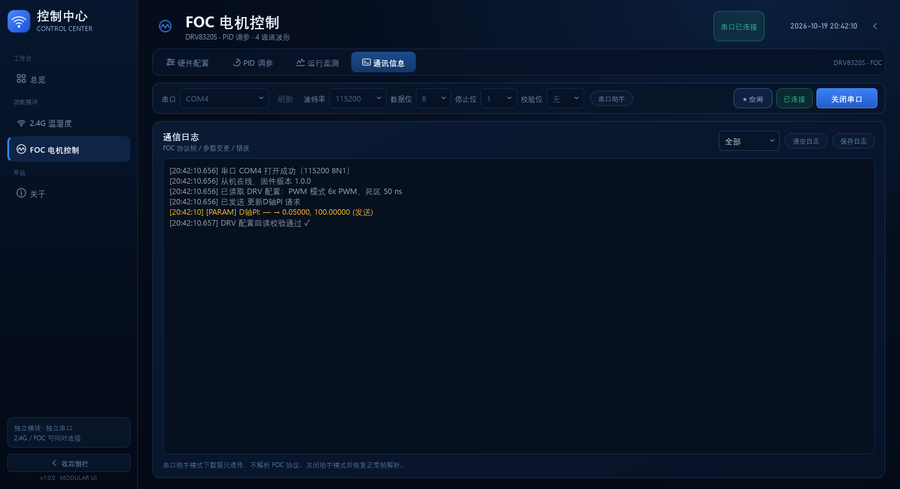
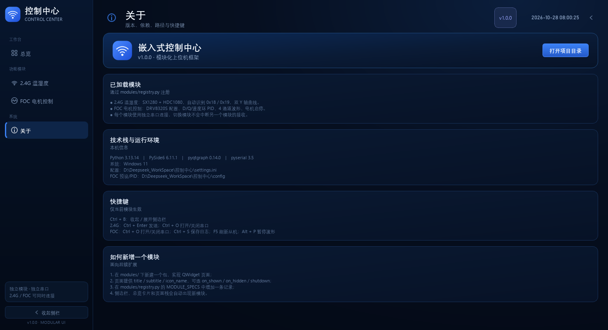

# 2.4G / FOC 控制中心

一个深蓝主题的模块化嵌入式上位机，把原先两个独立脚本收敛到同一个桌面窗口：

- **2.4G 温湿度**：SX1280 + HDC1080，双 Y 轴实时曲线、RSSI/SNR、丢包率、最近数据、CSV 导出、串口助手与 0x18/0x19 协议解析。
- **FOC 电机控制**：DRV8320S 配置、D/Q/速度环 PID、电机参数、启动/强拖参数、4 通道遥测波形、电机对齐/启停、FOC 协议日志与串口助手。

左侧只保留**一条可折叠的应用级侧边栏**；每个模块内部再用顶部二级标签组织页面。2.4G 与 FOC 使用**独立串口、独立设置**，切换模块时后台串口不会被强制断开。

> 截图中的曲线、寄存器值和日志来自虚拟串口 `loop://` 与合成数据，用于展示界面；不代表真实硬件测试结果。

---

## 界面

### 总览 / 可折叠侧边栏



侧边栏展开 226 px、收起 72 px。收起后只显示图标并保留 tooltip，状态会被记住；右侧页头也有展开/收起按钮。



### 2.4G 温湿度

数据监控：指标卡、双 Y 轴曲线、链路质量、最近 3 条样本。



串口通信：原始字节 + 协议帧日志、HEX/时间戳/自动滚动、通信统计、协议帧构造器、ASCII/HEX 发送与周期发送。



### FOC 电机控制

FOC 内部不再使用第二层左侧栏，改为顶部四个二级标签：

`硬件配置` / `PID 调参` / `运行监测` / `通讯信息`

#### 硬件配置

16 项 DRV8320S 参数按 4×4 卡片排列；读取、写入、回读校验、清除故障、从机验证放在同一页头。



#### PID 调参

D 轴电流环、Q 轴电流环、速度环、电机参数四张卡片横向排布；前两张可切换 Kp/Ki 分段范围，速度环为 Kp/Ki/Kd，电机参数卡支持读取/写入 `R / Ld / Lq / 磁链 / 极对数`。顶部“下发全部 PI”先发 `0x02`（D/Q 四参数），确认后发 `0x03`（速度环）；预设栏仍支持保存/加载/删除 PID 参数。



#### 运行监测

- 遥测通道标题与 11 个变量胶囊在同一行，每个胶囊按文字宽度自适应，不再使用分组框和说明文字。
- 4 张波形卡片；每张卡片右上角通过菜单选择信号源，不再占用左侧栏。
- 右侧栏放转速范围与启动参数卡（对齐/强拖 5 项，`0x08/0x0A`，掉电恢复默认）。
- “电机控制”标题与控件在同一行；“启动/停止”为普通胶囊，转速滑块包在圆角胶囊内，整行控件统一 32px 高。
- 原“斜坡”改为“下发间隔”：运行中按设定间隔周期重发目标转速 `0x01`，默认 250ms。
- 波形缓存 600 点、20 Hz 刷新、持续自动缩放并开启抗锯齿；保持和老版一致的观感。
- 串口读取按 5ms 攒包，原始日志改用 Qt 环形文档（最多 5000 行）并关闭 undo 历史，避免小 chunk 和日志增长拖垮事件队列。



#### 通讯信息

协议帧/参数变更/错误日志，可按 Tx/Rx/错误/参数过滤，支持清空与保存；串口助手开启后额外显示发送行。



### 关于

显示版本、依赖、路径、快捷键与新增模块步骤。



---

## 快速开始

### 1. 环境

已在 Python 3.13 + Windows 11 下验证：

| 依赖 | 版本 |
| --- | --- |
| Python | 3.13 |
| PySide6 | 6.11.1 |
| pyqtgraph | 0.14.0 |
| pyserial | 3.5 |
| numpy | 2.5.1 |

首次使用建议在 `控制中心` 目录创建独立虚拟环境：

```bat
cd /d D:\Deepseek_WorkSpace\控制中心
python -m venv .venv
.venv\Scripts\python.exe -m pip install -r requirements.txt
```

### 2. 运行

双击：

```text
控制中心\run.bat
```

或手动：

```bat
cd /d D:\Deepseek_WorkSpace\控制中心
.venv\Scripts\python.exe app.py
```

`run-debug.bat` 会保留控制台并显示退出码，便于排查启动问题。

默认窗口按屏幕自适应，当前 1536×864 屏幕下约为 1476×804；最小 1280×800。窗口位置、大小、最后打开的模块、侧边栏状态、两个模块各自的标签页和串口设置都会保存到 `控制中心\settings.ini`。

### 3. 连接串口

1. 选择左侧的 `2.4G 温湿度` 或 `FOC 电机控制`。
2. 在模块页头的串口栏选择端口、波特率（默认 115200）、8N1。
3. 点击 `打开串口`。
4. 两个模块可以同时打开不同串口；切换模块不会断开另一个模块。

---

## 代码结构

```text
控制中心/
├─ app.py                     # QMainWindow、侧边栏、页头、页面栈、设置持久化
├─ core/
│  ├─ theme.py                # 深蓝调色板、QSS、下拉箭头/勾选资源生成
│  ├─ widgets.py              # SectionCard / MetricCard / SegmentedTabs / StatusPill 等
│  ├─ sidebar.py              # 应用级可折叠侧边栏
│  ├─ icons.py                # QPainter 线条图标
│  ├─ protocol.py             # 0x5A 帧、CRC8、流式解析
│  ├─ serial_worker.py        # 通用 QThread 串口读线程
│  └─ settings.py             # QSettings 包装（settings.ini）
├─ modules/
│  ├─ registry.py             # 模块注册表：侧边栏、总览卡片、页面栈都从这里生成
│  ├─ overview/               # 总览 + 关于页
│  ├─ lora/                   # 2.4G：protocol / chart / page
│  └─ foc/                    # FOC：protocol / logic / ui / page
├─ docs/                      # README 截图
├─ tests/
│  └─ test_protocol.py        # 纯协议层自检（13 项）
├─ requirements.txt
├─ run.bat
└─ run-debug.bat
```

### 为什么拆成这些文件

- `core/` 只放跨模块复用的主题、控件、串口、协议和设置。
- `modules/lora/`、`modules/foc/` 各自持有协议、业务和页面，不互相 import。
- `modules/registry.py` 是唯一需要改动的“模块清单”；新增功能不需要动 `app.py` 的导航逻辑。
- FOC 原始业务逻辑（串口、遥测、DRV、PID、波形、日志）集中在 `modules/foc/logic.py` 的 `FocLogicMixin`，UI 在 `modules/foc/ui.py`，页面装配在 `modules/foc/page.py`，避免把 2000 多行继续堆进一个文件。

---

## FOC 原界面重排对照

原 `FOC-Python/Text.py` 的左侧是一列功能按钮；控制中心把应用级导航收归主侧边栏，FOC 内部改成：

| 原位置/控件 | 新位置 |
| --- | --- |
| 左侧“硬件配置 / PID / 运行监测 / 通讯”按钮 | FOC 页头顶部二级标签 |
| 波形通道选择按钮 | 每张波形卡片右上角 `QMenu` |
| 转速范围 | 运行监测右侧栏 |
| 启动参数（对齐/强拖） | 运行监测右侧栏 `0x08/0x0A` 卡片 |
| 电机参数 | PID 调参页第四张卡片 `0x0B/0x0C` |
| 电机控制/启停 | 运行监测顶部“电机控制”切换面板 |
| 串口助手开关 | FOC 串口栏中的“串口助手”chip；开启后跳到通讯页并显示发送行 |
| 清空/保存日志 | 通讯页右上角 |

这样只有**一条左侧栏**，FOC 内部功能仍然分区清晰，且不会和主侧边栏争夺视觉层级。

---

## 协议

两个模块共用同一种串口帧格式：

```text
0x5A | CMD | LEN | DATA[LEN] | CRC8
```

- CRC8：多项式 `0x07`，初值 `0xFF`，输入/输出不反转，结果异或 `0x00`。
- CRC 覆盖 `CMD + LEN + DATA`，不包含帧头 `0x5A` 和 CRC 自身。
- 多字节字段为小端。
- 解析器支持粘包、拆包和 CRC 错误后的重新同步。

2.4G：

- `0x19` 接收端上报（温度/湿度/序号/RSSI/SNR）。
- `0x18` 本机发送/回环。
- 帧构造器自动计算 LEN 与 CRC。

FOC（v1.1）：

- `0x01` 目标转速（int16）、`0x02` 电流环 PI（4×float）、`0x03` 速度环 PID（3×float）。
- `0x04` 启动、`0x05` 停止、`0x06` 请求遥测、`0x07` 版本、`0x09` 仅对齐。
- `0x08/0x0A` 启动/强拖参数读写（20 字节）、`0x0B/0x0C` 电机参数读写（17 字节）。
- `0x13/0x14/0x15` DRV 配置读取/写入/清故障、`0x17` 遥测掩码+主动上报、`0x18` 遥测、`0x19` 调试模式。
- `0x80` ACK、`0x82~0x87` 错误应答、`0x88` 故障上报、`0x89` 对齐完成。
- 遥测转速按有符号 `int16` 解析；D/Q 轴 PI 各 4 个值，其余字段按掩码顺序拼接。

---

## 快捷键

| 快捷键 | 作用 |
| --- | --- |
| `Ctrl + B` | 收起 / 展开侧边栏 |
| `Ctrl + Enter` | 2.4G 串口页发送 |
| `Ctrl + O` | 2.4G / FOC 打开或关闭串口 |
| `Ctrl + S` | FOC 保存日志 |
| `F5` | FOC 刷新从机 |
| `Alt + P` | FOC 暂停/恢复波形 |

> FOC 原来用 `Space` 暂停波形；控制中心改为 `Alt + P`，避免在日志过滤框、串口助手输入框中无法输入空格。

---

## 新增一个模块

1. 在 `modules/` 下新建包，例如 `modules/power/`。
2. 写一个 `QWidget` 页面，提供：
   - `title`、`subtitle`、`icon_name`
   - 可选 `on_shown()` / `on_hidden()` / `shutdown()`
   - 可选 `connection_changed = Signal(bool)` / `is_connected` 属性
3. 在 `modules/registry.py` 的 `MODULE_SPECS` 中加一条 `ModuleSpec`（key、名称、副标题、图标、描述、标签、factory）。
4. 如需新图标，在 `core/icons.py` 的 `draw_icon()` 中加一个分支；也可以复用已有 `monitor` / `hardware` 等图标。

启动后侧边栏、总览卡片、页面栈会自动出现新模块，不需要改 `app.py` 的导航代码。

---

## 设置与配置

| 内容 | 路径 |
| --- | --- |
| 控制中心窗口/侧边栏/最后模块/各模块串口设置 | `控制中心\settings.ini` |
| FOC PID 配置与预设 | `控制中心\config`（`pid_config.json` / `presets.json`） |
| 2.4G CSV 导出 | 保存对话框选择 |
| FOC 波形 CSV / 日志 | 保存对话框选择 |

---

## 测试与验证

### 已执行

```bat
.venv\Scripts\python.exe tests\test_protocol.py
```

结果：**13 项协议测试全部通过**，覆盖 CRC、0x18/0x19 解码、粘包/拆包、CRC 错误重同步、FOC 遥测长度、启动参数/电机参数结构、0x02 四参数、协议默认参数帧等。

### 离屏 UI / 虚拟串口回归

在 `QT_QPA_PLATFORM=offscreen` 下实际启动并操作了完整控制中心：

- 启动、四个侧边栏页面、FOC 四个二级标签、关于页、协议说明弹窗。
- 侧边栏展开/收起、折叠状态恢复、最后模块恢复、FOC/2.4G 标签页恢复。
- 关闭窗口时串口线程正常停止（无 `QThread destroyed while running`）。
- 2.4G：打开 `loop://`，注入 181 帧，验证指标卡、双曲线、链路质量、最近 3 条、CSV（6 行）、帧构造器、HEX 发送、日志统计。
- FOC：打开 `loop://`，验证从机验证、0x18 遥测入库与曲线、有符号转速、PID 统一下发（0x02 四参数 + 0x03）、启动/停止、转速间隔、启动参数/电机参数读写、错误/故障/对齐事件、DRV 配置回读、串口助手、日志和 CSV。
- FOC 稳定性压力：3 张波形、约 600 帧/秒、持续 15 秒，未再出现随时间加重的卡顿；渲染已恢复为 600 点全量、20 Hz、持续自动缩放和抗锯齿，串口读取按 5ms 攒包，日志使用 Qt 环形文档。

### 未执行 / 限制

- 当前环境没有真实 COM 口和 STM32 硬件，**未做真实硬件联调**；`loop://` 只验证上位机软件链路。
- 界面验证使用 **offscreen** 渲染，未在真实桌面上做人工目视验收（截图由 offscreen 生成）。
- FOC 的 ACK 超时、DRV 回读不一致等场景会弹 `QMessageBox`，属于原逻辑行为；自动化测试中需要屏蔽模态框。
- 默认按 1476×804 优化；1280×800 下运行监测页可完整显示，硬件配置/PID/通讯页仍按需使用滚动。
- 未做 PyInstaller 打包；当前以源码 + 虚拟环境运行。

---

## 备份与未修改文件

为满足“不要直接改原脚本”的要求，以下文件保持原样，仅作为功能参考：

- `FOC-Python/Text.py`（原始 FOC 上位机）
- `2.4GLora/main.py`（原始 2.4G 上位机）

控制中心内的对应实现是重新拆分/重排后的版本；FOC 的协议与业务逻辑从原脚本抽取到 `modules/foc/logic.py`，并按 `STM32/FOC/通信协议.md` v1.1 更新了命令/应答处理。原两个脚本仍可独立运行，作为回退方案。
